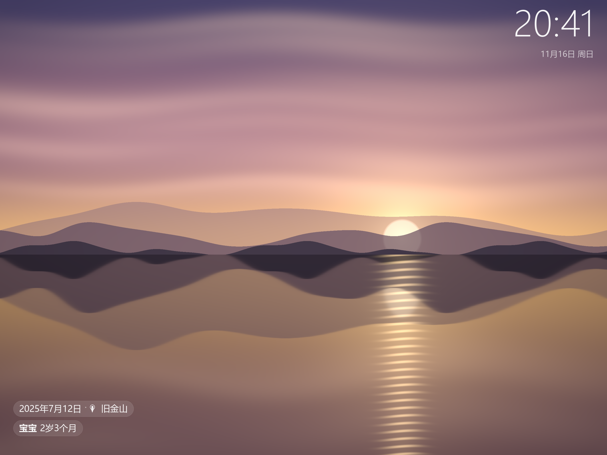

# 灯箱 Lantern

> 把你的共享相簿变成一面自己会换照片的墙。



原生 SwiftUI，iOS 16.6+，无第三方依赖，无账号，无订阅，不联网（除了 iCloud 自己把照片送下来）。

## 现成方案差在哪

| 现成做法 | 问题 |
| --- | --- |
| 照片 App 的「回忆」影片 | 算法替你挑片子，你管不了播哪本相簿、按什么顺序 |
| Keynote / PowerPoint 循环播放 | 加一张照片就要改一遍文件、重新导出一次 |
| 投屏到电视（AirPlay / 接 Mac） | 得有台常开着的 Mac 或者 Apple TV，多一个会崩的环节 |
| 买台数字相框 | 注册账号、上传照片、按月订阅，照片还进了别人的服务器 |

灯箱只做一件事：**把某个相簿铺满这块屏，一直播下去，新照片自动进场。**

## 它做什么

- **共享相簿优先**：相簿列表第一段就是「iCloud 共享相簿」。家人在自己手机上往里加照片，墙上几秒内就出现。
- **无人值守**：隐藏状态栏与 Home 指示条、禁止自动锁屏、控件 4 秒自动收，只留画面。
- **实况照片真播**：`PHLivePhotoView` 播完整一段，不是当静帧显示。
- **视频无控件**：裸 `AVPlayerLayer`，画面上一个系统按钮都没有。
- **Ken Burns**：静帧缓慢推近／拉远，偶数页推近、奇数页拉远，不机械。
- **「完整显示」不黑边**：填不满的部分用同一张图高斯模糊垫底。
- **多窗口**：iPadOS 上可以同时开两个窗口，各播各的相簿（Stage Manager / 分屏）。
- **按相簿记位置**：关掉再打开，接着上次那张继续。
- **水印**：左下角常显这张的拍摄日期；有 GPS 坐标就在后面加上 📍地点（系统反查，串行且按 100m 缓存）；还能再填一行日期计算，比如按拍摄日期算出「宝宝 2岁3个月」。

## 目录

```
lantern/
├── project.yml                     XcodeGen 工程定义（无 .xcodeproj 入库）
├── docs/preview.png                README 效果图（由 tools/make_preview.py 合成）
├── Lantern/
│   ├── LanternApp.swift            @main，单 WindowGroup（天然多窗口）
│   ├── RootView.swift              NavigationStack + 值路由
│   ├── Info.plist
│   ├── Assets.xcassets/            AppIcon（1024 单尺寸）+ 启动底色 + 强调色
│   ├── Models/
│   │   ├── SlideshowSettings.swift 全部偏好，@Published + 手动回写 UserDefaults
│   │   ├── SlideItem.swift         PHAsset 的值快照（含坐标两个 Double）
│   │   ├── AgeLabel.swift          日期计算：生日 + 拍摄日期 → 「2岁3个月」
│   │   └── SlideDeck.swift         轮播引擎：位置、暂停、generation 代次、预取窗口
│   ├── Services/
│   │   ├── PhotoLibraryService.swift  相簿枚举 + 资源查询 + 变更观察 + 稳定排序
│   │   ├── ImageLoader.swift          解码缓存（cachedImage 供同步命中）
│   │   ├── MediaLoader.swift          实况照片 / 视频取件（视频走 .fastFormat）
│   │   ├── LocationNamer.swift        坐标 → 地名反查（串行 + 按 100m 缓存）
│   │   ├── PreloadPipeline.swift      图片/实况预取：后续 6 张取完放进自己的 NSCache
│   │   ├── VideoWarmPool.swift        视频预热池：建 AVPlayer + 等 ready + preroll，容量 3
│   │   ├── VideoQualityUpgrader.swift 「先糊后清」：后台要高清副本，缓冲盖住播放头后交给第二层淡化上去
│   │   └── HDVideoCache.swift        把升过清晰的视频原片存本地，留最近 3 个（LRU，按文件 mtime）
│   ├── Support/
│   │   ├── AppLog.swift            os.Logger 门面
│   │   ├── AudioSession.swift      把音频会话抬到 .playback（实况照片出声的前提）
│   │   ├── DisplayMetrics.swift    屏幕像素尺寸（预取与正式请求必须同尺寸）
│   │   ├── LivePhotoContainer.swift    PHLivePhotoView 包装（isMuted 可配）
│   │   └── PlayerLayerContainer.swift  裸 AVPlayerLayer 包装（禁 AirPlay、接受外部 player）
│   └── Views/
│       ├── AlbumListView.swift     选相簿（含权限两态）
│       ├── SlideshowView.swift     轮播主视图 + 手势 + 双闸门计时 + 底部控制条
│       ├── SlideContent.swift      三种素材的统一渲染 + 缓存优先取件
│       ├── ChromeOverlay.swift     右上角 84pt 时钟（无渐变、无阴影）
│       ├── VideoScrubber.swift     视频进度条（底部常规位置，可拖 seek）
│       ├── DateBadge.swift         左下角日期 / 地点 / 日期计算水印
│       ├── FlipEffect.swift        「立体翻页」用的 rotation3DEffect 过渡修饰
│       └── SettingsSheet.swift     设置面板 + 画面填充子页
└── tools/
    ├── make_icon.py                用 numpy 生成图标（可重现）
    ├── make_preview.py             用 numpy 合成 README 效果图（可重现）
    ├── publish.py                  没有 git 也能把仓库推到 GitHub 的小脚本
    └── swift_lint.py               无 Xcode 环境下的结构体检
```

## 构建

### 本地（macOS）

```bash
brew install xcodegen
xcodegen generate
open Lantern.xcodeproj      # 直接 ⌘R，签名已经配好
```

`DEVELOPMENT_TEAM` 填进 `project.yml` 之后，重跑 `xcodegen generate` 也不会丢签名。
真机三步：iPad 上开「设置 → 隐私与安全性 → 开发者模式」；Xcode 里确认 Automatically manage signing；
⌘R。跑起来后在 iPad 的「设置 → 通用 → VPN 与设备管理」里信任一次开发者。

### 没有 Mac：GitHub Actions

CI 定义在 `.github/workflows/build.yml`；本仓库里同时留了一份同内容的 `ci/build.yml`
（推送用的 token 没有 workflow 权限，所以先落在 `ci/`）。把它复制成
`.github/workflows/build.yml` 提交一次就启用了。它会做三件事：

1. `lint` job（ubuntu）：跑 `tools/swift_lint.py` 和 `tools/make_icon.py`，保证源码结构和新图标可重现；
2. `build` job（macos-15）：`xcodegen generate` → 模拟器编译（**真正的编译检查**）→
   真机 Release 构建（不签名）→ 组装 `Lantern-unsigned.ipa`；
3. 可选 `sign`（勾 `workflow_dispatch` 的 sign 输入）：用 Secrets 里的 `P12_BASE64` /
   `P12_PASSWORD` / `MOBILEPROVISION_BASE64` 签出 `Lantern-signed.ipa`。

产物在 Actions 页面的 Artifacts 里。

## 设置项一览

| 分组 | 项 | 默认 | 说明 |
| --- | --- | --- | --- |
| 节奏 | 照片停留 | 6 秒 | 2–60 秒；实况照片也按这个停（它的动画放完就算） |
| 节奏 | 视频停留 | 播完为止 | 0 = 整段播完；设了秒数会被视频自身时长封顶，等于「最多看这么久」 |
| 节奏 | 顺序 | 最早在前 | 最早/最新/最近 50 张优先再随机/全随机 |
| 素材 | 播放实况照片 | 开 | 关掉就退化成静态图 |
| 素材 | 跳过视频 | 关 | |
| 素材 | 视频声音 | 关 | 客厅里突然冒声音比没声音更糟 |
| 素材 | 视频自动升清晰 | 开 | 起播先给 `.fastFormat` 抢时间，后台取 `.highQualityFormat` 后**交叉淡化**换上去（不中断播放）；关掉就一直播低清（省流量） |
| 素材 | 留下看过的高清视频 | 开 | 把升过清晰的原片存进 `Caches/HDVideoCache/`，留最近 3 个（LRU）；下次同一个视频直接本地高清起播。关掉立刻清空 |
| 外观 | 切换效果 | 缓慢推近 | 推近/淡入淡出/横向滑动/翻页推挤/立体翻页/缩放淡入/直接切换/随机 |
| 外观 | 画面填充 | 全部铺满 | 竖屏照片、横屏照片、竖屏视频、横屏视频各一个「铺满/完整显示」；完整显示时背后垫模糊底 |
| 外观 | 推近幅度 | 9% | 0–25%；选「随机」时也生效（随机池里含推近） |
| 外观 | 画面压暗 | 0% | 夜间挂客厅用 35% 左右 |
| 行为 | 显示时钟 | 开 | `TimelineView` 每秒刷新，后台自动降频；84pt 大字 + 18pt 日期，无渐变无阴影 |
| 水印 | 显示拍摄日期 | 开 | 左下角常显，不随控制条消失 |
| 水印 | 显示拍摄地点 | 开 | 跟在日期后面，如「2025年9月5日 · 📍广州」，无坐标则不显示 |
| 水印 | 显示日期计算 | 关 | 填称呼 + 日期，每张照片下面写「宝宝 2岁3个月」 |
| 行为 | 视频进度条 | 开 | 只对视频生效；位于控制条上方，可按住拖动 seek |
| 行为 | 记住上次位置 | 开 | 按相簿分别记 |

## 已知边界

- **只能读系统相簿**：不做自有云同步。想让 iPad 看到照片，就建 iCloud 共享相簿。
- **iCloud 原图未下载时会转圈**：首次播放某张存在 iCloud 的照片，会显示「正在获取下一张」。
  预取窗口是 6 张，所以只有「跳着翻」或者「刚打开就飞快连点」才会碰到；
  碰到时这几秒不计入停留时间，画面出来才开始数。
- **预取占内存**：6 张全屏解码图 + 最多 3 个预热好的 `AVPlayer`（每个都带着一路解码器和半秒缓冲）。
  这是「翻页零等待」的代价：图片窗口在 `SlideshowView.preloadWindow` 里可调，视频池容量在 `VideoWarmPool.capacity`。
- **视频用 `.fastFormat` 起播**：iCloud 上的原片会优先给一段能马上播的近似流，所以刚出画面时是糊的。
  `VideoQualityUpgrader` 会在后台要一份 `.highQualityFormat`，等它缓冲到能盖住播放头、
  并把位置重新对齐到当前播放点，就把它交给**第二层 `AVPlayerLayer` 做 0.28 秒交叉淡化** ——
  低清那份一秒都不停，所以看不到换档。通常两三秒后画面自己变清楚。
  不想折腾就在设置里关掉「视频自动升清晰」，代价是一直播低清（流量更省）。
  代价：淡化那 0.28 秒里有两路解码器同时在跑（多占一点内存和电），淡完立刻停掉低清那路。
- **高清会落盘留 3 个**：淡入完成后 `HDVideoCache` 用 `PHAssetResourceManager.writeData`
  把原片写进 `Caches/HDVideoCache/`，文件名的版本号取自素材 `modificationDate`
  ——素材在「照片」里被剪过就自动作废重下。下次同一个视频直接 `AVPlayerItem(url:)` 本地起播，
  不联网、没有低清阶段、也不需要再升一次。
  保留策略是 LRU（每次命中 touch 一次 mtime），最多 3 个、总量上限 2 GB；
  存在 `Caches` 里，系统存储吃紧时可以直接回收，后果只是要重新下一次。
- **地点靠系统反查**：`CLGeocoder` 有频率限制，代码里已串行 + 按坐标缓存（约 100m 一档），
  但一次翻很多新地点时会出现「地点晚一两秒才补上」。没有 GPS 坐标的照片（截图、保存的网图）不显示地点。
- **只认系统解码得动的格式**：交给系统解码，系统不认识就取不到。
- **竖屏时 Ken Burns 的锚点是中心**：`zoomIn` 只调幅度不调焦点，脸不在中心时推近会偏。

## 下一步（想做的）

- **图片落盘**：视频已经有 `HDVideoCache`，照片还是一个 `NSCache`（退出就没了）。
  同理可以按「最近 200 张 / 上限 1 GB」落盘，让第二天打开还是零等待。

## 许可

源码归你。图标与效果图分别由 `tools/make_icon.py`、`tools/make_preview.py` 生成，同样归你。
